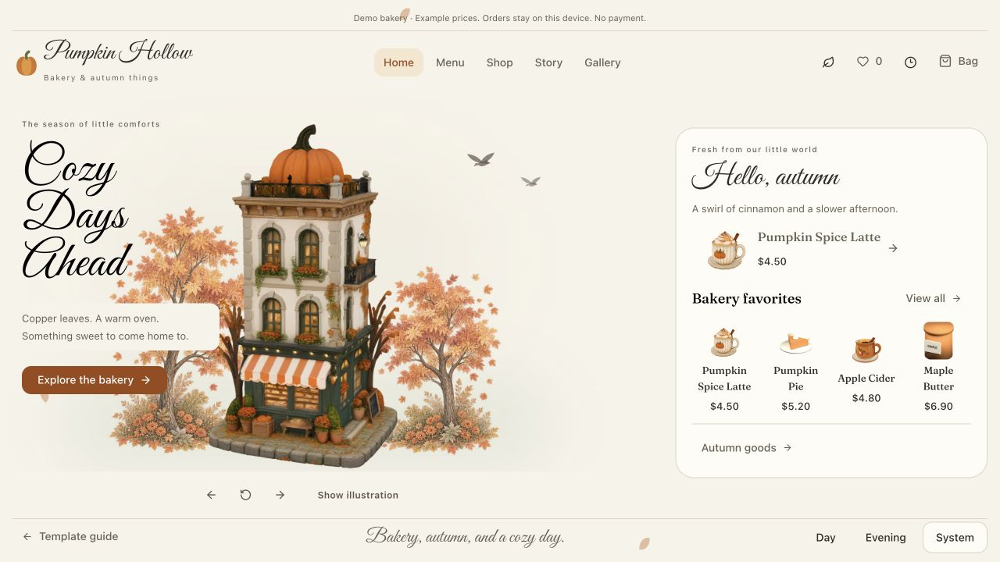
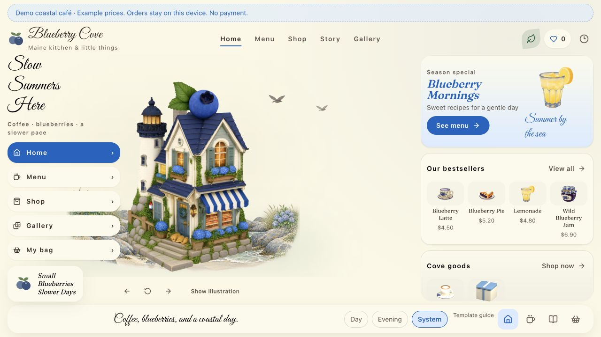

# Little Storefronts

**Two ready-built, interactive 3D storefronts — Pumpkin Hollow & Blueberry Cove.**

**English** · [简体中文](README.zh-CN.md) · [Credits](CREDITS.md)

| Pumpkin Hollow | Blueberry Cove |
| --- | --- |
|  |  |
| An autumn bakery | A seaside kitchen |

The two storefronts I shared on Xiaohongshu, packaged for downloading and exploring.
This repository contains the **ready-built HTML/CSS/JavaScript websites**, including
their models and pictures. No Node.js, package installation, build step or API key
is needed to use them.

## Download and open

1. Choose **Code → Download ZIP** on GitHub, then extract the entire archive.
2. Open either `pumpkin-hollow/` or `blueberry-cove/`.
3. Open `README.html` for the illustrated guide and `index.html` for the storefront.

Each theme folder is a complete, independent website. Keep its files together.
The package is designed to support opening `index.html` directly, but `file://`
behavior still needs manual verification in your browser. Static HTTP is the
verified preview path. For example, if Python is installed, run this from the
repository folder:

```sh
python3 -m http.server 8000
```

Then visit [Pumpkin Hollow](http://localhost:8000/pumpkin-hollow/) or
[Blueberry Cove](http://localhost:8000/blueberry-cove/).

Individual theme ZIPs can also be attached to
[GitHub Releases](https://github.com/dom-liu/little-storefronts/releases).
Release attachments are separate from GitHub's complete repository ZIP; a release
is not automatically published by this repository.

## Make it yours

Edit **`shop-config.js`** inside either theme, save and refresh the page:

| Setting | Changes |
| --- | --- |
| `shopName`, `subtitle`, `tagline` | Website branding and footer |
| `hours` | Opening-hours popover |
| `hero`, `story` | Three hero lines and story paragraphs |
| `menu` | Four product names, numeric USD prices, descriptions and photo paths |
| `orderUrl` | Optional external HTTPS ordering link; leave empty to hide |

Keep the existing menu IDs and valid JavaScript syntax. Replace photos in
`assets/photos/` using the same filenames, or change their configured paths.
Website names and photos do not alter lettering or textures baked into 3D models.
The seven 3D models are embedded in `assets/model-data.js`; standalone GLB copies
are omitted to keep downloads smaller. Model changes need a new export from the
development project.

## What's included

```text
pumpkin-hollow/          blueberry-cove/
├── index.html          # Storefront entry
├── shop-config.js      # Editable content
├── app.js              # Ready-built application
├── style.css
├── assets/             # Photos and embedded 3D models
├── README.html         # Illustrated guide
├── PROVENANCE.html
├── licenses/           # Third-party notices
└── package-manifest.json
```

Rotate buildings and products, browse the menu, switch Day / Evening / System,
and try illustration mode. Interactive 3D needs a recent desktop browser with
WebGL2. The experience is desktop-first; browser compatibility is not universally
verified. The application uses English copy; this repository also has a Chinese README.

Shops, products and USD prices are fictional. Favorites, bags and preview receipts
stay on the device. They do not place orders or charge money. An optional external
ordering link does not connect the demonstration bag to an ordering service.

## Hosting and packaging

Upload **one complete theme folder** to a static web host, preserving all relative
paths. It needs no server functions or build command. Nothing is deployed by cloning
or opening this project.

Maintainers with Python can verify files and create the two download ZIPs:

```sh
python3 scripts/check.py
python3 scripts/package.py
```

Versioned ZIPs and `SHA256SUMS.txt` appear under ignored `out/`. Existing deliveries
are kept. These commands do not deploy a website or publish a Release.

## License and credits

The root [MIT license](LICENSE) applies to project-owned documentation and
configuration. The compiled runtime retains the notices in each theme's `licenses/`.
**Models, images and textures are not covered by the root MIT grant**; see
[artwork terms](ASSET_LICENSE.md). This is a static distribution, not the React
source project.

The visual starting point was **Strawberry Corner** by
[Dilum Sanjaya](https://x.com/DilumSanjaya). The themes use AI-assisted concept
images, Tencent Hunyuan 3D V3.1 and Blender refinement. Attribution and AI generation
do not establish originality or third-party permission. See [Credits](CREDITS.md).
Only Pumpkin Hollow and Blueberry Cove are included.
